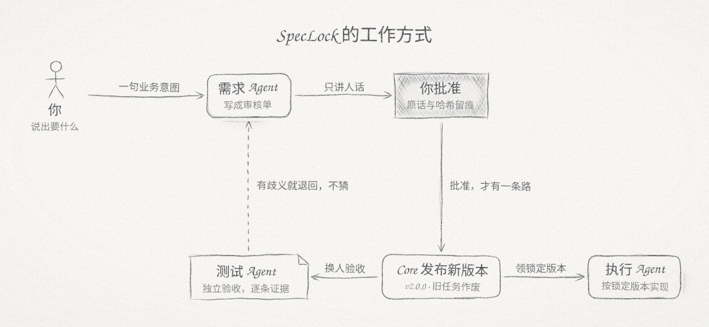
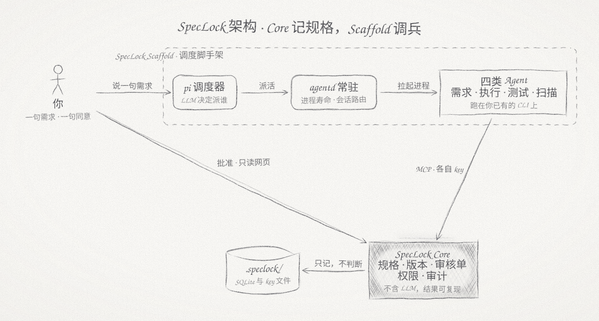

**为 AI Agent 团队设计的业务规格基础设施。**

Agent 能干活，是因为它自由；它能糊弄你，也是因为这份自由。麻烦在于，信任没法建立在提示词上——提示词是软的，Agent 读得懂，也绕得开。它绕不开的只有系统：SpecLock 把规格锁起来，Agent 只读已发布的版本，想改只有"人点头"这一条路；任务钉在版本上，做完要有逐条证据，验收换一个 Agent。

**判断交给 LLM，真相留给记录。** 这是整个系统唯一的设定——LLM 可以错，记录不会。

它不是 Agent，也不是 Agent 框架，而是 Agent 团队底下那层确定性的记录。

## 为什么需要它

Agent 提高了写代码的速度，验证没有跟上：产出是否可信，仍然要靠人逐项确认。任务和 Agent 一多，确认本身就成了瓶颈。

- **"完成"是它自己声明的。** 它的目标是让任务通过，而不是让结果正确；测试不通过时，修改需求往往比修改代码更省事。实现和验收出自同一个会话，这样的验收不构成约束。
- **需求文档没有修改控制。** 谁都能改，没有版本，没有批准记录。出现不一致时，说不清改动是否经过确认，也说不清当前代码对应哪一版需求。
- **执行状态依附于会话。** 进行到哪一步、为什么这样决策，只存在于上下文里；会话结束，这些信息随之丢失，接续工作只能靠人工整理和转述。

## 现有的 spec 工具呢？

SDD 的方向没错——动手之前先把需求说清楚。但现在这批工具大多走偏了：

- **管得太多。** 模板从业务意图一路管到架构和实现设计，代码还没写，文档先填了一摞——这些本该由 Agent 边写边定，不该提前替它做主。
- **文档腐化。** 没有机制保证文档跟着代码走，第一版写完就开始漂，三个月后代码早跑没影了，文档还在原地。
- **假装写给人看。** 这些 spec 声称留给人审，一字一句读它的其实只有 Agent。既然消费者是 Agent，为什么不直接面向 Agent 设计？SpecLock 就这么干：每个模块的规格是一份最小工作集——背景、规则、验收条件、API，多一行没有；Agent 读它、照它实现、拿它验收，人只看审核单那个人话版本，批完就走。
- **不够 AI native。** 它们假设"人写文档、AI 照着做"，而现实是 Agent 在写代码：权限靠提示词恳求，进度跟着会话走，做完了没证据——Agent 团队的失灵模式，一个都没堵住。

SpecLock 的取舍相反：判断和真相分开存放。判断交给 Agent，真相锁进 Core，中间只有"审核单 → 人批准"一条通道；管到"做什么、怎么算做对"为止，架构和实现交还给 Agent。

## 工作方式



人只看审核单：为什么变、变成什么样、怎么算做对，都是人话。拆成哪些模块、怎么写进规格库，是需求 Agent 的事。批准之后发布新版本，执行 Agent 领到的是锁定在这个版本上的完整规格；规格再变，没做完的旧任务自动作废。

## 它做到什么

- **信任来自机制，不来自自觉。** 每个 Agent 一把角色 key，越界系统直接拒绝——自己批准自己、验收自己的实现、跨项目偷看都不行。每条验收条件要附证据，验收换一个 Agent 来做；另有只读的扫描 Agent，通读全部规格找矛盾。批准带原话和内容哈希，审计记下谁、何时、对什么做了什么。
- **真相只有一个源，入口是人。** 唯一的写入口是"审核单 → 人批准 → Commit"，网页、嵌入、导出全是只读视图；规格有歧义，Agent 只能显式卡住，不能猜着改。实现层同理——代码即文档，业务真话在规格库，实现真话在代码里。
- **真相外置于会话。** 待办、锁定版本的规格、逐条证据、审计都在 `.speclock/` 里，会话断了，新会话领到任务接着干，不用把历史聊天喂回去；规格发布新版本，没做完的旧任务自动作废，不存在照着旧文档写代码的空窗。
- **文档面向真实读者。** Agent 读的是最小工作集——背景、规则、验收条件、API，多一行没有；人只看审核单，全是人话，从不需要读 diff 或模块拆分。

## 架构



整个系统分三层：判断层是四类 Agent 和它们的 LLM，记录层是 Core，调度层是 Scaffold——LLM 只出现在判断层，真相只在记录层。

SpecLock Core 只负责记录：规格、版本、审核单、执行记录、权限和审计，不含任何 LLM，结果可以复现。Agent 团队怎么组起来——谁什么时候被叫醒、消息怎么转发、每个进程活多久——是外面那层调度脚手架（SpecLock Scaffold）的事：pi 调度器读你的话派活，agentd 守着进程和会话，需求、执行、测试、扫描四类 Agent 跑在你已有的 CLI 上，各自凭一把 key 从 MCP 领到锁定版本的规格。对话记录、运行回执、交接文档都落盘存档，看板读记录就行，不必向 Agent 要历史。每个 Agent 该怎么做事，写在 [`roles/`](roles/) 的提示词里；脚手架只管调兵，规格的真话只在 Core 这边。

## 快速开始

需要 Python 3.11 以上。

```bash
pip install -e .                       # 在 SpecLock 源码目录里
cd /path/to/your/project
speclock init                          # 创建 .speclock/，生成你的 admin key
speclock serve                         # 启动服务；网页免登录、只读
speclock key create --role requirements-agent --label 需求
```

最后一条会打印一段可以直接放进 Agent `.mcp.json` 的配置。把 [`roles/`](roles/) 里对应的提示词放进它的 `AGENTS.md`，这个 Agent 就可以开始工作了。完整步骤见[使用指南](docs/GUIDE.md)。

## 文档

- [使用指南](docs/GUIDE.md)：安装、两种用法、接入 Agent、key 的存放、批准、备份与导出
- [参考手册](docs/REFERENCE.md)：完整的特性、接口、规则和 33 个 MCP 工具
- [网页嵌入](docs/EMBED.md)：把只读网页嵌进你自己的前端
- [角色提示词](roles/)：需求、执行、测试、扫描 Agent 的工作守则
- [开发指南](docs/DEVELOPMENT.md)：产品边界、设计决策、代码地图
- [版本记录](docs/CHANGELOG.md)

## License

MIT
