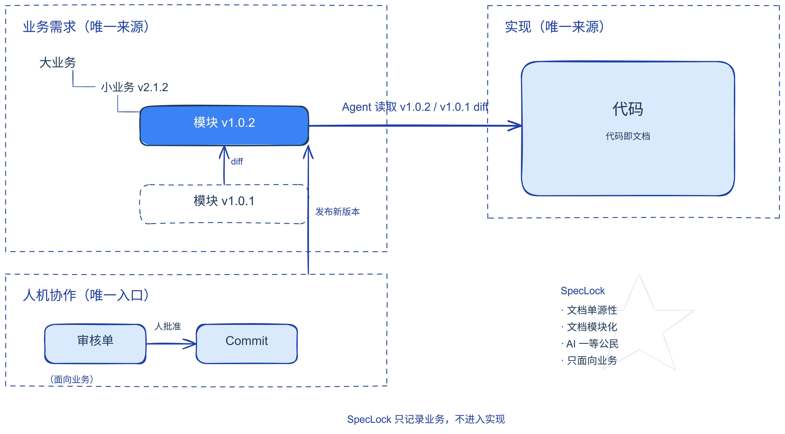

**业务需求只有一个来源：SpecLock；实现只有一个来源：代码。**

SpecLock 是为 AI Agent 团队设计的业务规格记录层。业务需求由需求 Agent 整理、经人批准后在这里版本化并发布；执行 Agent 按锁定版本实现。

我相信，SDD 在解决文档腐化、控制文档范围并完成相应的 AI Native 改造之后，会成为 AI 落地过程中最能保证业务准确性的开发范式。

`Python 3.11+` · `MIT` · `MCP`

## 1. 现在 AI Coding 的痛点

Agent 进入真实项目后，写代码不再是主要瓶颈，确认产出是否可信才是。

- Agent 说"完成了"，但缺少可核对的证据：它可能为了通过任务去改测试、mock 或需求文档，也可能按自己的理解补充业务规则、增加没有被要求的功能。
- 需求没有单一来源，也没有唯一版本：同一个业务规则散落在聊天记录、文档、代码注释和 Agent 提示词里，改过几轮后，说不清哪一版是最终口径、哪一版经过批准。
- 和 Agent 讨论需求时，很难把话题留在业务层：你问业务口径，它答技术方案；业务和技术混在一起，人还没对齐业务，就先做了技术判断。

## 2. 现有的 spec 工具为什么不行

SDD 本身没有问题，明确需求相当重要，但多数工具存在三个问题：

- **管理范围过大。** 从业务意图一直管到架构、实现设计和任务拆分，文档量超过 Agent 完成任务所需。
- **文档会腐化。** 文档在仓库里，Agent 可读也可写；没有机制保证文档与代码同步，也没有机制阻止 Agent 修改需求。
- **假装写给人看** 规格按功能或阶段展开，整份文档、多文件拆分，没有稳定的业务模块索引；Agent 只能整份读取，难以按模块定位，也分不清哪些是必须遵守的业务约束。

## 3. SpecLock 是如何解决的

SpecLock 只做记录，不做判断。它用三个设计原则解决上面的问题：

- **单源性。** 业务需求只有一个来源：SpecLock 的已发布版本；实现只有一个来源：代码。读取只能访问已发布版本，修改只能走审核单 → 人批准 → Commit。
- **模块化。** 规格按 项目 → 大业务 → 小业务 → 模块 组织。模块按业务划分，可单独交给一个 Agent；每个模块有独立版本，变更后可按模块查看 diff。Agent 先读索引，再按需加载相关模块，不加载全量规格。
- **轻量、只面向需求。** 只需要一份需求 spec，按照AI Native的方式设计，每个模块只规定业务背景、业务规则、验收条件、API，不生成架构、设计、计划和任务文档；结构固定、可按模块加载，方便 Agent 阅读。它只回答"做什么、怎么算做对"，不回答"怎么做"。

核心结构：



工作流程：

1. 需求 Agent 将业务意图整理成审核单。
2. 人批准后，需求 Agent 提交 Commit，SpecLock 发布不可变的模块新版本，变更可按模块查看 diff。
3. 执行 Agent 领取锁定版本的规格并完成实现；实现留在代码里，代码即文档。
4. 另一个 Agent 独立验收；每条验收条件都要有证据，实现者不能验收自己的结果。

规格更新后，旧版本上未完成的任务自动作废。

## 快速开始

需要 Python 3.11 以上和 [uv](https://docs.astral.sh/uv/)。仓库是 monorepo（`packages/` 里是按层依赖的几个 Python 包，`apps/web` 是网页），`uv sync` 一次装全：

```bash
git clone <本仓库> speclock
cd speclock && uv sync
```

```bash
cd /path/to/your/project
speclock init                           # 创建 .speclock/，生成你的 admin key
speclock serve                          # 启动服务；网页免登录、只读
speclock key create --role requirements-agent --label 需求
```

最后一条会打印一段可以直接放进 Agent `.mcp.json` 的配置。把 [`roles/`](roles/) 里对应的提示词放进它的 `AGENTS.md`，这个 Agent 就可以开始工作了。完整步骤见[使用指南](docs/GUIDE.md)。

## 文档

- [使用指南](docs/GUIDE.md)：安装、两种用法、接入 Agent、key 的存放、批准、备份与导出
- [参考手册](docs/REFERENCE.md)：完整的特性、接口、规则和 33 个 MCP 工具
- [网页嵌入](docs/EMBED.md)：把只读网页嵌进你自己的前端
- [角色提示词](roles/)：需求、执行、测试、扫描 Agent 的工作守则
- [开发指南](docs/DEVELOPMENT.md)：产品边界、设计决策、代码地图
- [版本记录](docs/CHANGELOG.md)

## License

MIT
