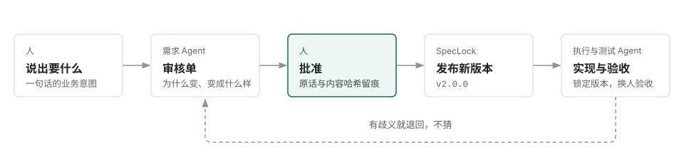
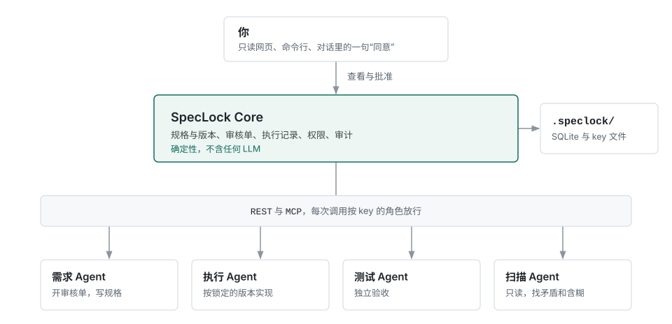

**为 AI Agent 团队设计的业务规格基础设施。**

当写代码的是 Agent，需求就不能再是一份谁都能改的文档。SpecLock 把规格锁起来：Agent 只读已发布的版本，想改只有一条路，而且要人点头；每个任务钉在一个版本上，做完要有证据，验收由另一个 Agent 完成，每一步都有记录。

它不是 Agent，也不是 Agent 框架，而是 Agent 团队底下那层确定性的记录。

## 为什么需要它

把需求写成 Markdown 放进仓库，对人来说够用。动手的换成 Agent 以后，问题就来了：

- 测试过不去，Agent 会顺手把需求改掉，然后报告完成。
- 需求改过几轮，说不清这段代码是照哪一版写的。
- "做完了"只是一句话，没有逐条证据，也没有第二个人验过。

## 工作方式



人只看审核单：为什么变、变成什么样、怎么算做对，都是人话。拆成哪些模块、怎么写进规格库，是需求 Agent 的事。批准之后发布新版本，执行 Agent 领到的是锁定在这个版本上的完整规格；规格再变，没做完的旧任务自动作废。

## 架构



SpecLock 只负责记录：规格、版本、审核单、执行记录、权限和审计。谁什么时候被叫醒、消息怎么转发，交给你自己的 Agent 框架；每个 Agent 该怎么做事，写在 [`roles/`](roles/) 的提示词里。

## 原则

- **规格只能经人批准修改。** 唯一的写入通道是审核单到 Commit，靠权限保证，不靠提示词。
- **人管意图，Agent 管结构。** 人从不需要读 diff 或模块拆分。
- **每次实现都对应一个版本。** 领任务时拿到的规格不会在中途变。
- **完成需要证据。** 每条验收条件都要附证据，验收者不能是实现者。
- **Core 不做判断。** 不含任何 LLM，结果可以复现；判断留给 Agent，授权留给人。

## 快速开始

需要 Python 3.11 以上。

```bash
pip install -e .                       # 在 SpecLock 源码目录里
cd /path/to/your/project
speclock init                          # 创建 .speclock/，生成你的 admin key
speclock serve                         # 启动服务；网页免登录、只读
speclock key create --role requirements-agent --label 需求
```

最后一条会打印一段可以直接放进 Agent `.mcp.json` 的配置。把 [`roles/`](roles/) 里对应的提示词放进它的 `AGENTS.md`，这个 Agent 就可以开始工作了。完整步骤见[使用指南](docs/GUIDE.md)。

## 文档

- [使用指南](docs/GUIDE.md)：安装、两种用法、接入 Agent、key 的存放、批准、备份与导出
- [参考手册](docs/REFERENCE.md)：完整的特性、接口、规则和 33 个 MCP 工具
- [网页嵌入](docs/EMBED.md)：把只读网页嵌进你自己的前端
- [角色提示词](roles/)：需求、执行、测试、扫描 Agent 的工作守则
- [开发指南](docs/DEVELOPMENT.md)：产品边界、设计决策、代码地图
- [版本记录](docs/CHANGELOG.md)

## License

MIT
